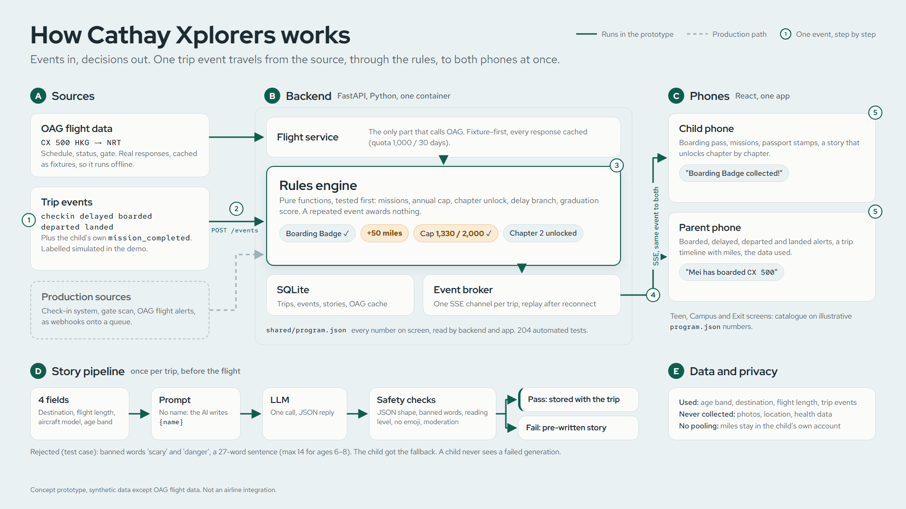

# Architecture slide: content and look

For the team to build in Canva. One main slide; an optional second one follows. Everything here matches the finished prototype (`docs/architecture.md`).

## Sample visual



`docs/architecture-visual.png` (1920×1080) is a reference to follow in Canva. Its source is `docs/architecture-visual.html`: edit the text there and re-render, or copy the colours and spacing. The lettered parts map to "Text for each box" below:

| Part | On the visual | Expand with |
|---|---|---|
| **A** Sources | OAG flight data, Trip events, Production sources (dashed) | "Sources" |
| **B** Backend | Flight service, Rules engine (hero), SQLite, Event broker, `program.json` line | "Backend" |
| **C** Phones | Child phone, Parent phone, Xplorers note | "Phones" |
| **D** Story pipeline | 4 fields → Prompt → LLM → Safety checks → Pass / Fail, rejection line | "Story pipeline strip" |
| **E** Data and privacy | Used, never collected, no pooling | "Data panel" |
| **1–5** | One `boarded` event: source → `POST /events` → rules → SSE → both phones | "Hero callout" |

Presenter line, tracing the numbers: "A gate scan arrives (1) as one event (2). The rules engine decides: badge, 50 miles, still under the cap, chapter 2 opens (3). It's published once (4), and both phones show their own version at the same moment (5)."

## Look (matches the app, DESIGN.md)
- **Background** Sky `#EAF1F3`. **Boxes** Paper `#FBFCFA`, 16px corners, 1px Line `#D3DEE1` border, no shadow except on the hero box: `0 1px 2px` and `0 8px 24px`, both Ink at 8%.
- **Text** Ink `#1D2B33` for titles, Ink soft `#56666D` for details. Nothing lighter.
- **Arrows** Jade `#0E5E4E`, 2px, solid = runs in the prototype. Dashed Line `#D3DEE1` = production path.
- **Orange** `#F2A033` only on the miles figures (+50, 1,330 / 2,000). No other colours, no gradients, no logos.
- **Fonts** (Canva has all three): Red Hat Display 700 for the title and box headers; Red Hat Text for body; Red Hat Mono only for flight data, endpoints and event names (`CX 500`, `HKG → NRT`, `POST /events`, `boarded`).
- **One hero:** the event path through the rules engine across the middle. Make it the biggest and darkest element. The other parts are smaller and quieter.
- Sentence case, left-aligned. No capital-letter labels with spacing.

## Layout (16:9)

```
┌──────────────────────────────────────────────────────────────────────────────────────────┐
│ How Cathay Xplorers works                                                                │
│ Events in, decisions out.                                                                │
│                                                                                          │
│  Sources                 Backend (FastAPI, Python)                  Phones (React)       │
│ ┌──────────────┐        ┌────────────────────────────────────┐     ┌──────────────────┐ │
│ │ OAG flight   │───────▶│ Flight service                     │     │ Child phone      │ │
│ │ CX 500       │ cached │ only OAG caller, fixture-first     │     │ boarding pass,   │ │
│ │ HKG → NRT    │        ├────────────────────────────────────┤     │ missions, stamps,│ │
│ └──────────────┘        │ ★ Rules engine                     │ SSE │ story chapters   │ │
│ ┌──────────────┐        │ Boarding Badge ✓  +50 miles        │════▶├──────────────────┤ │
│ │ Trip events  │───────▶│ cap 1,330 / 2,000 ✓                │ one │ Parent phone     │ │
│ │ checkin      │ POST   │ chapter 2 unlocked                 │event│ "Mei has boarded │ │
│ │ delayed      │/events ├────────────────────────────────────┤     │  CX 500", trip   │ │
│ │ boarded ...  │        │ Event broker: one channel per trip │     │ timeline, data   │ │
│ └──────────────┘        ├────────────────────────────────────┤     └──────────────────┘ │
│ ┌ ─ ─ ─ ─ ─ ─ ┐         │ SQLite: trips, events, stories,    │      Teen, Campus, Exit │
│  Production:    ─ ─ ─ ▶ │ OAG cache                          │      screens: catalogue │
│ │ check-in,   │         └────────────────────────────────────┘      on program.json    │
│   gate scan,             shared/program.json: every number                             │
│ │ OAG alerts  │                                                                         │
│  ─ ─ ─ ─ ─ ─ ─                                                                           │
│ Story pipeline: once per trip, before the flight                                         │
│ 4 fields ──▶ Prompt ──▶ LLM ──▶ Safety checks ──▶ Pass: stored, unlocks with the trip    │
│ (no name)              (JSON)                  └─▶ Fail: pre-written fallback            │
│                                   Rejected (test case): 'scary', 'danger',               │
│                                   27-word sentence (max 14)                              │
│                                                                                          │
│ ── runs in the prototype   - - production path        Concept prototype, synthetic data │
└──────────────────────────────────────────────────────────────────────────────────────────┘
```

Put the data panel in the right margin under the phones, or as a footer band:
**Used:** age band, destination, flight length, trip events. **Never collected:** photos, location, health data. **Miles stay in the child's own account. No pooling.**

## Text for each box

**Sources**
- **OAG flight data.** `CX 500 HKG → NRT`: schedule, status and gate. Real OAG responses, cached as fixtures, so the demo runs offline.
- **Trip events.** `checkin`, `delayed`, `boarded`, `departed`, `landed`, and the child's own `mission_completed`. In the demo they're labelled *simulated*.
- **Production (dashed).** Check-in from the departure control system, the gate scan, OAG flight alerts, all as webhooks onto a queue.

**Backend (FastAPI on Python, one container)**
- **Flight service.** The only part that calls OAG. Fixture-first; every response is cached.
- **Rules engine (hero).** Pure functions, tested first: missions, the annual cap, chapter unlock, the delay branch, the graduation score. A repeated event awards nothing, so messy feeds are safe.
- **Event broker.** Each event is published once to the trip's channel over Server-Sent Events. A phone that drops off catches up from the last event it saw.
- **SQLite.** Trips, events, stories, OAG cache.
- **shared/program.json.** Every number on screen (miles, cap, score bands) is read by both backend and app.
- Footnote, small: *204 automated tests.*

**Phones (React and TypeScript, one app, two screens)**
- **Child phone.** Boarding pass, missions, passport stamps, and a story that unlocks chapter by chapter.
- **Parent phone.** Boarded, departed, delayed and landed alerts, a trip timeline with miles, and the data used.
- Both get **the same event**, and each shows its own version.
- Quieter note: *Teen, Campus and Exit screens: catalogue on illustrative program.json numbers.*

**Hero callout: one event through the system.** Number the steps along the Jade arrows:
1. Gate scan
2. `POST /events  boarded`
3. Rules engine: Boarding Badge ✓, **+50 miles**, cap **1,330 / 2,000** ✓, chapter 2 unlocked
4. One event, sent to both phones
5. Child: "Boarding Badge collected!" Parent: "Mei has boarded CX 500"

**Story pipeline strip**
- **4 fields:** destination, flight length, aircraft model, age band. The child's name is never sent; the AI writes `{name}`, and the backend fills it in.
- **LLM:** one call per trip, before the flight. JSON reply.
- **Safety checks:** JSON shape and chapters, banned words, reading level for the age band, no emoji or markdown, provider moderation.
- **Pass:** stored with the trip; each chapter unlocks at its trip moment; the landing chapter unlocks by the schedule, no GPS needed.
- **Fail:** the pre-written fallback story. *A child never sees a failed generation.*
- Inset, small: *Rejected (safety check, test case): banned words 'scary' and 'danger', a 27-word sentence (max 14 for ages 6–8). The child got the fallback.* Source: `docs/story-rejection-example.md`. If `tools/generate_story.py` catches a real model rejection, use that and drop "test case".

## Optional second slide: "From demo to production"
Three columns: **In the demo**, **In production**, **Why it holds**. Five rows, from `docs/architecture.md` "Production path":

| In the demo | In production | Why it holds |
|---|---|---|
| Events posted by the demo panel | Check-in system, gate scan, OAG alerts as webhooks onto a queue | The rules engine doesn't care where an event comes from. |
| Miles and cap in SQLite | Rules decide; the loyalty ledger records and enforces the cap | An accrual-rules service, not a second bank of miles. |
| Server-Sent Events, one instance | Phone push for alerts, managed pub/sub for the live view | SSE shows the sync on stage; push scales. |
| One AI call per trip | Batch job when online check-in opens, cached per booking | Nothing is generated in flight. |
| Four data fields, consent shown as passed | Child sub-account under a guardian, consent at sign-up (HK PDPO) | Minimisation is enforced in code. |

## Wording rules
- Footer on both slides: "Concept prototype, synthetic data except OAG flight data."
- Never say "Cathay integration", and never use a Cathay logo.
- Quote only numbers from program.json or api.md (+50, 1,330 / 2,000, 204 tests, 1,000 OAG requests / 30 days).
- If a judge asks whether the phones in the video are live: the screens run on scripted events in the exact API event shape, and the same backend run is shown by `tools/demo_trip.py`.
